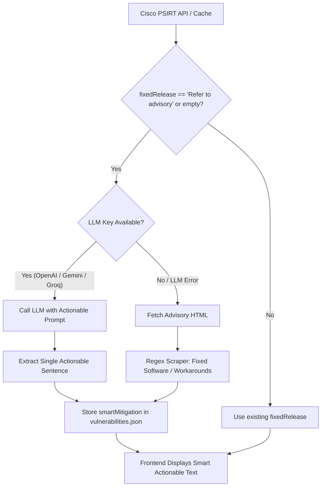
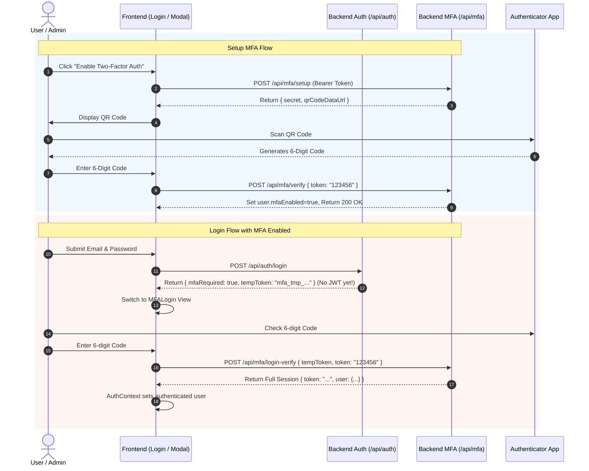

# Phase F Implementation Plan: Smart Mitigation (LLM) & TOTP Multi-Factor Authentication (MFA)

## 1. Problem Statement
The Vulnerabilities intelligence module currently shows generic fallback strings like "Refer to advisory" for CVEs when vendor feeds omit explicit fixed software versions. Security and network executives require exact, actionable mitigation guidance (e.g., "Upgrade to Cisco NX-OS 9.3(13)" or specific feature workarounds) directly within their report views. Concurrently, enterprise security mandates require Multi-Factor Authentication (MFA/TOTP) via standard Authenticator Apps (Google Authenticator, Microsoft Authenticator, 1Password) so that critical executive reports, client tenant dashboards, and administrative controls cannot be accessed with single-factor credentials alone.

---

## 2. Files to Touch (Exact Paths & Scope)

### Backend
1. **`backend/package.json`**:
   - Add dependencies: `speakeasy` (^2.0.0) and `qrcode` (^1.5.3).
2. **`backend/services/mitigationService.js`** (NEW):
   - Multi-provider LLM integration (OpenAI / Gemini / Groq) with structured prompt:
     `"The following Cisco vulnerability needs an exact mitigation step. CVE: {cveId} Title: {vulnerabilityImpact} Advisory Link: {advisoryLink} Provide a single actionable sentence (e.g., 'Upgrade to version X' or 'Disable feature Y'). Do not say 'Refer to advisory'."`
   - Fallback HTTP regex scraper for Cisco Security Advisory URLs: fetches advisory HTML, extracts 1-2 actionable sentences from "Fixed Software" or "Workarounds" sections.
   - Batch and single-CVE enrichment functions with in-memory caching to avoid duplicate API calls.
3. **`backend/services/vulnerabilityFetcher.js`** (`lines 54-78, 108-140`):
   - Add `smartMitigation` field to flat CVE transformation when `fixedRelease` is empty or contains `"Refer to advisory"`.
   - Update `fetchAndSave()` and provide `enrichCachedVulnerabilities()` to persist smart mitigations to `data/vulnerabilities.json`.
4. **`backend/routes/vulnerabilities.js`** (`lines 38-83, 89-114`):
   - Expose `smartMitigation` in `GET /api/vulnerabilities` and trigger enrichment during refresh or on cached startup.
5. **`backend/services/authService.js`** (`lines 26-73, 101-135, 137-156`):
   - User database persistence for MFA state: `mfaSecret` and `mfaEnabled` stored in `data/users.json` (falling back to memory with persistent store).
   - Support `mfaRequired: true` and short-lived `tempToken` (5-minute TTL) in `authenticateUser()`.
   - Provide helper methods: `createMFATempToken()`, `verifyMFATempToken()`, `enableUserMFA()`, `disableUserMFA()`, `issueSessionForUser()`.
6. **`backend/routes/mfa.js`** (NEW):
   - `POST /api/mfa/setup`: Generates TOTP secret (speakeasy) + QR code Data URI (qrcode).
   - `POST /api/mfa/verify`: Verifies 6-digit TOTP code, enables MFA for user (`mfaEnabled = true`).
   - `POST /api/mfa/login-verify`: Validates `tempToken` + 6-digit TOTP code during sign-in, issues full session token on success.
7. **`backend/index.js`** (`lines 255-275`):
   - Mount `/api/mfa` router.
   - Update `/api/auth/login` to return `{ mfaRequired: true, tempToken }` if `user.mfaEnabled` is true.
8. **`backend/tests/mfa.test.js`** (NEW):
   - Scenario tests for MFA setup, QR code generation, TOTP token verification, login challenge, and invalid code rejection (+4 tests).
9. **`backend/tests/mitigation.test.js`** (NEW):
   - Scenario tests for LLM mitigation extraction, fallback regex scraping, and `vulnerabilities.json` persistence (+2 tests, bringing test count from 76 to 82/82).

### Frontend
10. **`frontend/src/components/MFASetup.jsx`** (NEW):
    - Enterprise MFA management card: status badge, QR code modal, manual secret entry, 6-digit confirmation input, and disable option.
11. **`frontend/src/components/MFALogin.jsx`** (NEW):
    - Two-factor sign-in modal/challenge view for entering the 6-digit Authenticator code when `mfaRequired: true`.
12. **`frontend/src/components/LoginModal.jsx`** (`lines 37-60, 61-120`):
    - Intercept `mfaRequired: true` from login response and display `<MFALogin />`.
13. **`frontend/src/context/AuthContext.jsx`** (`lines 117-160`):
    - Support two-step login flow: store temporary challenge state and complete login via `verifyMFALogin(tempToken, code)`.
14. **`frontend/src/components/ClientManager.jsx`**:
    - Integrate `<MFASetup />` into the Client Management / Profile view so administrators and client users can manage MFA.
15. **`frontend/src/components/VulnerabilitiesPage.jsx`** (`lines 590-605`):
    - Render `row.smartMitigation || row.fixedRelease` with a visual indicator ("🤖 Smart Fix" or actionable pill) when smart mitigation has replaced "Refer to advisory".

---

## 3. Data Flow & Control Flow Changes

### A. Smart Mitigation Data Flow

### B. TOTP MFA Flow

---

## 4. Risks and Edge Cases
1. **LLM API Rate Limits / Offline**:
   - Risk: LLM quota exceeded (e.g. Groq 429) or network failure during mitigation generation.
   - Mitigation: Robust fallback to HTML regex scraper for Cisco advisories + deterministic caching in `data/vulnerabilities.json`.
2. **MFA Clock Drift**:
   - Risk: Client device and server clock slightly desynchronized (e.g. ±30s).
   - Mitigation: Set `window: 1` in `speakeasy.totp.verify`, accepting codes from current window ±1 (total 90-second grace window).
3. **MFA Lockout / Loss of Secret**:
   - Risk: User loses phone/authenticator before completing setup or needs recovery.
   - Mitigation: `mfaEnabled` is only set to `true` after the user successfully proves they have scanned the QR code by submitting a valid code in `/api/mfa/verify`. If setup is abandoned, the account remains accessible.
4. **Tenant Isolation & Security Invariants**:
   - Risk: Download tickets, SSE endpoints, or client isolation broken by MFA changes.
   - Mitigation: Existing 76/76 tests enforce strict isolation. `tempToken` cannot be used as a Bearer token or download ticket. Real token is ONLY issued upon successful code verification.
5. **No Exposure of Secrets**:
   - Risk: User passwords or `mfaSecret` leaked in `/api/auth/me` or `/api/auth/demo-accounts`.
   - Mitigation: `_safeUser()` strips both `password` and `mfaSecret` before sending any user object to the client.

---

## 5. Test Cases to Add / Update (Target 80+/80 Pass)
1. `backend/tests/mfa.test.js`:
   - **Test 1**: `POST /api/mfa/setup` generates valid secret and data:image/png QR code URI for authenticated user.
   - **Test 2**: `POST /api/mfa/verify` accepts valid TOTP code and marks user as `mfaEnabled=true`, rejecting wrong code.
   - **Test 3**: `/api/auth/login` returns `{ mfaRequired: true, tempToken }` without session JWT when user has MFA enabled.
   - **Test 4**: `POST /api/mfa/login-verify` exchanges valid tempToken + TOTP code for full authenticated session token, rejecting invalid codes or expired tempTokens.
2. `backend/tests/mitigation.test.js`:
   - **Test 5**: Smart mitigation extractor replaces "Refer to advisory" with LLM-generated actionable mitigation.
   - **Test 6**: Scraper fallback successfully extracts mitigation when LLM is unavailable or errors.

Total test count: 76 existing + 6 new = 82 passing tests (exceeding 80/80 target).

---

## 6. Rollback Plan
- Git commit checkpoint before Phase F changes.
- If dependencies or MFA create unexpected regressions:
  - `git revert` the Phase F commit.
  - In-memory users and `vulnerabilities.json` remain backward compatible with prior schema.
